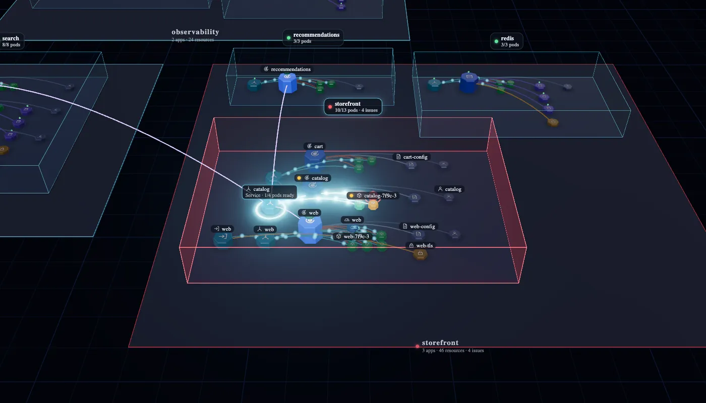
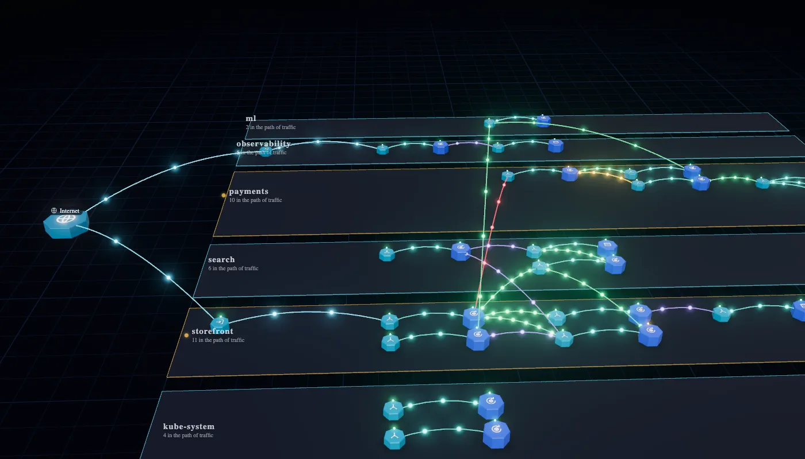

# App Graph

Every app in your Kubernetes cluster, wired up and alive in 3D, right inside Lens. See how each app is built, what is broken, and where its traffic flows.

## Features

- **Apps, not just resources.** Helm releases, Argo CD and Flux apps, and workloads become glass modules, each holding its Services, workloads, pods, config and volumes, in the order a request meets them.
- **See what is broken from across the cluster.** Crash-looping pods glow red, a broken app sends up a red beacon, and a reference to something missing, such as a Secret that does not exist, shows as a red wireframe.
- **Every link explained.** Click anything: the side panel lists what it uses and what uses it, down to the exact field that links them.
- **Live traffic.** The Traffic Graph follows every request from the internet through ingresses, gateways and routes to the Services and workloads behind them, and on to the Services they call.
- **Service mesh aware.** With Istio or Linkerd and Prometheus, every call shows its measured requests and errors: green while it succeeds, amber, then red as it fails.
- **GitOps and operators.** Argo CD Applications, Flux Kustomizations and HelmReleases, and operators' resources such as a Postgres cluster stand in the graph as what they are, with their health and a line to everything they manage.
- **Everything is live.** Pods come and go and lights change as the cluster changes.
- **Smooth on big clusters.** It draws only when something changes, and it works with limited permissions, namespace by namespace.

## Safe to use

- Nothing is installed in your cluster, and App Graph only reads from it. It never changes anything.
- Secret values are never read or kept: a Secret's data is dropped the moment it arrives.
- Prometheus is asked for mesh traffic only while a Traffic Graph is open, every 30 seconds.
- Whatever you are not allowed to list shows as unknown, never as missing.

## Install

[Open App Graph in Lens](https://app.k8slens.dev/lens-launcher?c=lens%3A%2F%2Fapp%2Fopen%2Fextension%3Fname%3Dlens-app-graph) and click Install there. The link offers Lens for download when it is not installed yet.

## Usage

- **Navigator:** open **App Graph** under any cluster, and **Traffic Graph** inside it.
- **Any resource list:** right-click a Deployment, Pod, Service, ConfigMap, … and choose **Show in App Graph**, or **Show in Traffic Graph** for Services, ingresses, routes and workloads. The graph opens on that resource.
- **Details panel:** workloads, pods, services, ingresses, config, volumes and ServiceAccounts get an **App Graph** section. It names the resource's app, lists any broken references, and opens the graph on it.
- **Command palette:** **App Graph: Open for this cluster** and **Traffic Graph: Open for this cluster**.

In the graph:

- **Click** a resource or an app to select it. **Double-click** a resource to open its details in Lens, or an app to fly into it.
- **Drag** to orbit, **right-drag** to pan, **scroll** to zoom.
- **Search** finds resources and apps by name. **Namespaces** narrows the view; choosing a single namespace also narrows what is watched.
- The **filter** button shows what is hidden by default: ReplicaSets, history (old ReplicaSets, finished Jobs, superseded Helm releases), shared resources, resources no app claims, and infrastructure (Nodes, classes, EndpointSlices).

| Key | Does |
|---|---|
| `L` | Labels |
| `P` | Problems only |
| `R` | Whole cluster |
| `F` | Fly to the selection |
| `Esc` | Clear the selection |
| `?` | Legend |

## What you see

- **Namespaces** are plates, and **apps** are glass modules standing on them. An app is a Helm release, an Argo CD or Flux application, everything sharing an `app.kubernetes.io/instance`, an operator's resource with what it owns, or a workload on its own. Services, config and RBAC join the app of whatever they are connected to.
- **Resources** are Kubernetes-style heptagon tokens with their kind's icon on top. They stand left to right in the order a request meets them: ingresses and routes, Services, workloads, pods, then the ConfigMaps, Secrets, volumes and ServiceAccounts they use. Autoscalers, disruption budgets, network policies and webhooks float over what they act on.
- **Health** is colour. Pods glow green, amber or red, workloads carry a status light, and apps take the colour of their worst resource.
- **Broken references** show as red wireframes. References into resources you are not allowed to list show as grey wireframes marked unknown.
- **Shared resources**, such as a ConfigMap two apps mount, stay outside both apps. The ones every app uses, like the `default` ServiceAccount and `kube-root-ca.crt`, are hidden unless you ask for them.
- **Who answers the API server.** Admission webhooks and aggregated APIs are linked to the Service behind them. If that Service is gone, the link shows as broken, since every request the webhook intercepts can fail.

## Traffic Graph

Only what is in the path of a request, one lane per namespace, flowing left to right.

- **Ways in:** Ingresses, Gateway API Gateways and routes, Istio Gateways with the VirtualServices bound to them, and LoadBalancer Services. A shared gateway, such as one in `istio-system`, stays in view when you choose only the namespaces it leads into.
- **Measured traffic:** with Istio or Linkerd, and Prometheus set up for the cluster in Lens, every call carries what the mesh measured over the last 5 minutes, for example `Istio saw 12 req/s · 3% errors`. Busier calls carry denser, faster packets. Traffic to a host outside the cluster ends at the ServiceEntry that declares it.
- **Mesh routing:** routes attached to a Service sit between it and the backends they split or mirror traffic to.
- **Inferred calls:** without a mesh, calls come from where a workload says it connects: a Service's DNS name in its environment, arguments or ConfigMaps (`http://orders:8080`, `DB_HOST=postgres`). Only names of existing Services are drawn, and Secrets are never read for this.

## Good to know

- Custom resources are included when the cluster serves them: Gateway API, cert-manager, External Secrets, Prometheus Operator, KEDA, Argo CD and Argo Rollouts, Flux, Istio, the Vertical Pod Autoscaler and device claims. Any other custom resource that owns something in the graph is listed as well, up to 24 kinds.
- Measured traffic reads `istio_requests_total` and `istio_tcp_*_bytes_total` (Istio), or `response_total` and `tcp_*_bytes_total` (Linkerd). The status line says when there is no Prometheus or no mesh traffic.
- Rendering pauses whenever the tab is hidden, and the ambient animation slows down, then stops, when you leave the view alone.

What changed in each version is in [CHANGELOG.md](./CHANGELOG.md).
