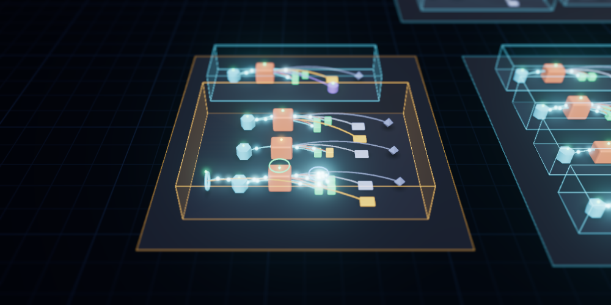

# App Graph

See every app in your cluster as a live 3D model: which resources make up each app, how they connect, and what is broken. A second view, the Traffic Graph, shows every path a request can take through the cluster.

## What it shows

- **Namespaces** are plates. **Apps** are glass modules standing on them. An app is a Helm release, an Argo CD or Flux application, everything sharing an `app.kubernetes.io/instance`, or a workload on its own. Services, config and RBAC join the app of whatever they are connected to.
- **Resources** are Kubernetes-style heptagon tokens with their kind's icon on top: the cube of a pod, the cycle of a Deployment, the padlock of a Secret. They stand inside their app in the order a request meets them, left to right: ingresses and gateway routes, services, workloads, pods, then the ConfigMaps, Secrets, volumes and ServiceAccounts they use. Autoscalers, disruption budgets and network policies float over what they act on.
- **Health** is colour. Pods glow green, amber or red, workloads carry a status light, and apps take the colour of their worst resource. Something broken sends a pulse along the floor, and an app with a broken resource sends up a red beacon you can see from across the cluster.
- **Broken references** show as red wireframes: a pod mounting a Secret that does not exist, an Ingress pointing at a missing Service. References into resources you are not allowed to list show as grey wireframes marked unknown, never as missing.
- **Shared resources**, such as a ConfigMap two apps mount, stay outside both apps as context. The ones every app uses, like the `default` ServiceAccount and `kube-root-ca.crt`, are hidden unless you ask for them.

## Traffic Graph

A simpler picture of the whole cluster at once: only what is in the path of a request, one lane per namespace, flowing left to right. From the internet to your ingresses, gateways and LoadBalancer Services, through routes to Services, from each Service to the workload behind it, and from workloads to the Services they call. Packets travel every connection. A namespace with many routes wraps into a block instead of one long column.

- **Ingress, Gateway API and Istio.** Traffic enters through Ingresses, Gateway API Gateways and their routes, and Istio Gateways with the VirtualServices bound to them (`spec.gateways`). A VirtualService bound only to `mesh` shapes traffic between sidecars, so it is not drawn as a hop. A shared gateway, such as one in `istio-system`, stays in view when you choose only the namespaces it leads into.
- **Measured traffic from a service mesh.** If the cluster runs Istio or Linkerd and Lens has Prometheus set up for it, the graph draws the calls the mesh measured over the last 5 minutes: green while they succeed, amber from 1% failing, red from 5%. Packets run denser and faster on busier connections, and the side panel shows the rate, for example `Istio saw 12 req/s · 3% errors`. Traffic leaving an ingress gateway is drawn on the routes it took. Prometheus is asked every 30 seconds, and only while a Traffic Graph is open.
- **Inferred calls.** Without a mesh, calls between services are inferred from where a workload says it will connect: a Service's DNS name in its environment variables, arguments, or the ConfigMaps it uses (`http://orders:8080`, `redis.cache.svc.cluster.local`, `DB_HOST=postgres`). Only names that match an existing Service are drawn; Secrets are never read for this.

Everything updates live as the cluster changes. The graph reads what Lens already watches and never queries the cluster per relationship.

## Where to find it

- **Navigator:** open **App Graph** under any cluster, and **Traffic Graph** inside it.
- **Any resource list:** right-click a Deployment, Pod, Service, ConfigMap, … and choose **Show in App Graph**, or **Show in Traffic Graph** for Services, ingresses, routes and workloads. The graph opens on that resource.
- **Details panel:** workloads, pods, services, ingresses, config, volumes and ServiceAccounts get an **App Graph** section. It names the resource's app, lists any broken references, and opens the graph on it.
- **Command palette:** **App Graph: Open for this cluster** and **Traffic Graph: Open for this cluster**.

## Using it

- **Click** a resource or an app to select it. The side panel explains every relationship: what it references, what references it, the rule that linked them, and the exact field (for example `spec.template.spec.volumes[2].secret.secretName`). Click any entry to jump to it.
- **Double-click** a resource to open its details in Lens, or an app to fly into it.
- **Drag** to orbit, **right-drag** to pan, **scroll** to zoom.
- **Search** finds resources and apps by name. **Namespaces** narrows the view; choosing a single namespace also narrows what is watched.
- The **filter** button shows what is hidden by default: ReplicaSets, history (old ReplicaSets, finished Jobs, superseded Helm releases), shared resources, resources no app claims, and infrastructure (Nodes, classes, EndpointSlices).

| Key | Does |
|---|---|
| `L` | Labels |
| `P` | Problems only |
| `R` | Whole cluster |
| `F` | Fly to the selection |
| `Esc` | Clear the selection |
| `?` | Legend |

## Good to know

- On shared clusters where you cannot list a kind cluster-wide, App Graph lists it namespace by namespace instead, and marks references it still cannot see as unknown.
- Secret values are never kept: the graph drops `data` and `stringData` as soon as a Secret arrives.
- Rendering pauses whenever the tab is hidden, and the ambient animation slows down, then stops, when you leave the view alone.
- Custom resources from Gateway API, cert-manager, External Secrets, Prometheus Operator, KEDA, Argo Rollouts, Istio (VirtualServices and Gateways) and the Vertical Pod Autoscaler are included when the cluster serves them.
- Measured traffic reads `istio_requests_total` and `istio_tcp_*_bytes_total` (Istio), or `response_total` and `tcp_*_bytes_total` (Linkerd), through the Prometheus configured in the cluster's settings. The status line says when there is no Prometheus or no mesh traffic.

What changed in each version is in [CHANGELOG.md](./CHANGELOG.md).
